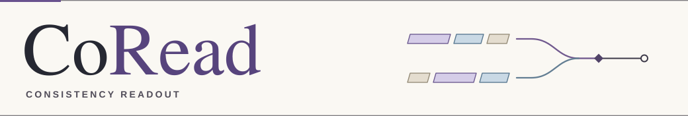
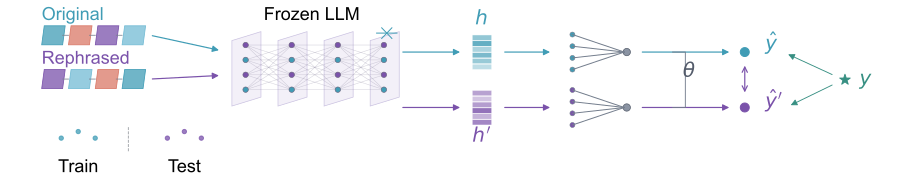
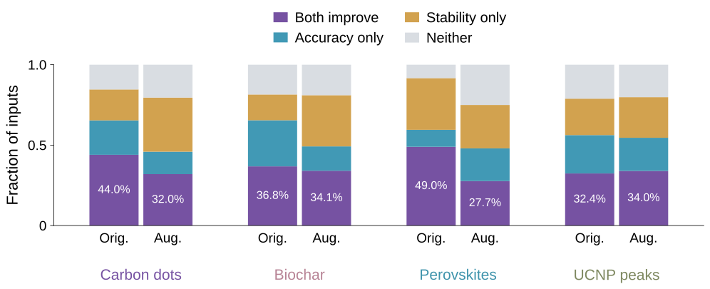
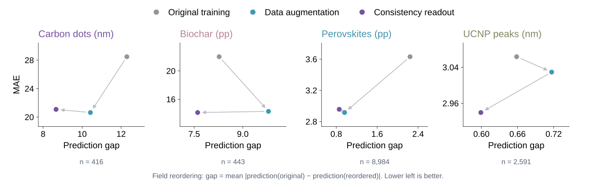

[Quickstart](#quickstart)　 [Results](#results)　 [Datasets](#datasets)　　 [简体中文](README.zh-CN.md)

## Predict material properties from experimental descriptions

Given a carbon-dot synthesis protocol, predict its room-temperature phosphorescence peak. CoRead extracts representations from a frozen language model and fits a readout to measured labels, constraining how far predictions can shift across equivalent descriptions.

> **Less sensitivity to field order.** Across four regression tasks, the mean gap between predictions before and after reordering was **10.8–22.3% smaller** than with ordinary data augmentation.

<details>
<summary><strong>How the readout works</strong></summary>



Original and rewritten inputs share readout parameters θ, with measured targets y providing supervision. Only an experimental description is needed for a new prediction.

</details>

## Quickstart

Start with `carbon_dot`. Run the following commands from the repository root with Python 3.10+. Skip the download if Qwen weights are already local.

```bash
python -m pip install ".[extract]"
hf download Qwen/Qwen2.5-7B-Instruct --local-dir models/pretrained/Qwen2.5-7B-Instruct
python run.py extract --data data/carbon_dot --model models/pretrained/Qwen2.5-7B-Instruct
python run.py demo --datasets carbon_dot
```

Find the measured and predicted values for each sample in `results/run_<timestamp>/carbon_dot/predictions.csv`. Extraction uses CUDA by default; the readout can then train on CPU.

<details>
<summary><strong>Switch datasets or extraction devices</strong></summary>

Skip the download if the model and tokenizer are already available locally. Extraction uses the local model and never downloads weights automatically. CUDA is the default; CPU extraction uses `--device cpu` and is much slower for a 7B model.

Generate features once for each selected dataset by changing the extraction command's `--data` path. The readout then trains on CPU and saves reusable models. Running `python run.py` without arguments uses the carbon-dot and biochar caches. Other selections:

```bash
python run.py demo --datasets carbon_dot biochar perovskite
```

Run either UCNP task with the same entry point:

```bash
python run.py demo --datasets ucnp_peaks
python run.py demo --datasets ucnp_detection
```

</details>

## Results

How often does the same input gain both accuracy and stability? Purple marks a strictly lower absolute error and a smaller prediction gap under field reordering. Each pair compares CoRead with original training (Orig.) and ordinary data augmentation (Aug.).



<details>
<summary><strong>Inspect accuracy and stability by task</strong></summary>



These four benchmarks use frozen 3,584-dimensional Qwen2.5-7B-Instruct representations. Relative to ordinary augmentation, MAE changed by **−3.0% to +2.2%**; lower is better. Here pp denotes percentage points and UCNP denotes peak-wavelength regression. Each task uses valid paired inputs and its own validation protocol.

</details>

## Datasets

| Dataset | Samples | Prediction target |
|---|---:|---|
| `carbon_dot` | 418 | Room-temperature phosphorescence peak (nm) |
| `biochar` | 443 | Soil cadmium immobilization ratio (%) |
| `perovskite` | 8,984 | Solar-cell power conversion efficiency (%) |
| `ucnp_peaks` | 2,639 | Peak wavelengths in seven emission bands (nm) |
| `ucnp_detection` | 10,807 | Presence in seven bands; 9,913 training / 894 validation |

**Sources and licences.** Carbon-dot and biochar records come from the authors' earlier studies, perovskite records from The Perovskite Database Project, and UCNP records from open-access articles in Europe PMC and publisher repositories; the UCNP prompts quote the experimental descriptions of these articles. The CC BY 4.0 data licence covers the labels, splits, rewrites and paraphrases created for this work; quoted article text remains under the licence of the original article.

## Usage reference

<details>
<summary><strong>Train, save and predict</strong></summary>

```bash
python run.py train --data data/carbon_dot --model models/readout/carbon_dot.npz
python run.py extract --data data/new_samples --model models/pretrained/Qwen2.5-7B-Instruct
python run.py predict --model models/readout/carbon_dot.npz --features data/new_samples --output results/predictions.csv
```

For new samples, first create `data/new_samples/prompts.jsonl.gz`. Each record needs a unique `sample_id` and either `text` or an already formatted `rendered_prompt`; labels are not required for prediction.

For your own scalar training data, use the bundled label/prompt schema and generate features with `extract`. Alternatively, replace `data/carbon_dot` with an NPZ containing `X` of shape `(samples, variants, features)` and `y` of shape `(samples,)`. Variant 0 is the original prompt; the others are equivalent rewrites. An optional boolean `available` mask has shape `(samples, variants)`.

`predict --features` accepts an extracted feature directory, a 2D `.npy` array, or an NPZ containing a 2D `features` array and optional `sample_id`. Training and prediction must use the same model, layer, input template, and preprocessing.

UCNP folders retain their seven-band labels: `target_B1..B7` are peak wavelengths in nm; `mlabel_B1..B7` are detection labels (`-1` unknown, `0` absent, `1` present). Missing targets stay missing and all accepted paraphrases are retained. The `train` command recognizes either UCNP folder automatically. The `predict` command outputs seven wavelengths for peaks, or seven probabilities and presence flags for detection.

</details>

<details>
<summary><strong>Python API</strong></summary>

```python
from consistency_readout import ConsistencyRidge, load_model

model = ConsistencyRidge().fit(X_train, y_train, available)
model.save("models/readout/carbon_dot.npz")
predictions = load_model("models/readout/carbon_dot.npz").predict(X_new)
```

UCNP Python adapters are `ConsistencyPeaks` and `ConsistencyDetection`; `load_model` restores the saved type automatically. Use `predict_proba` for detection probabilities.

</details>

<details>
<summary><strong>File locations, evaluation and reproducibility</strong></summary>

| Location | Contents |
|---|---|
| `run.py` | Entry script for `extract`, `train`, `predict`, and `demo` |
| `consistency_readout/` | The readout, input loaders, and fold splitting |
| `data/<dataset>/labels.csv`, `prompts.jsonl.gz` | Source inputs included in the repository |
| `data/<dataset>/features*.npz`, `features_manifest.json` | Generated local features and extraction checkpoints; ignored by Git |
| `models/pretrained/<model>/` | User-provided pretrained model and tokenizer; ignored by Git |
| `models/readout/` or `models/run_*/` | Trained readout weights; ignored by Git |
| `results/` | Metrics, predictions, and run information; ignored by Git |
| `tests/` | Tests for the method and complete usage workflow |

The repository includes source labels and prompts. NPZ representations are generated locally from Qwen2.5-7B-Instruct and are not committed. Extraction requires the pretrained model and appropriate compute; after extraction, readout training only needs the cached features and CPU dependencies (`python -m pip install .`).

Each example run saves `models/run_<timestamp>/<dataset>.npz` and `results/run_<timestamp>/` with `metrics.csv`, `manifest.json`, and `<dataset>/predictions.csv`. Existing models and results are not overwritten.

Scalar examples use five sample-level outer folds and three training-only inner folds; these do not establish unseen-paper or material-family performance. UCNP peaks use fixed component folds and scientific-group-weighted scores. UCNP detection uses its fixed external-paper validation partition and excludes unknown labels. Perovskite and UCNP peak runs are more computationally expensive.

Existing local caches can be reused for training. Extraction never overwrites them; `--resume` only accepts matching, verified checkpoints. A custom `--output-dir` contains features only, so training from that directory also requires the corresponding labels and prompts. Extraction records model/input hashes and runtime settings; different batching, precision, or backends are not guaranteed to reproduce historical feature arrays bit for bit. `data/features_manifest.json` is an optional historical reference, not a required download.

Run tests with `python -m unittest discover -s tests`. The optional tiny-model extraction test runs when the `extract` dependencies are installed.

</details>

**License** · Software: [MIT](LICENSE). Data: [CC BY 4.0](DATA_LICENSE).
