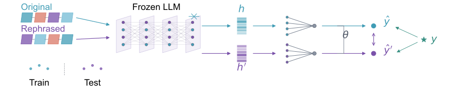
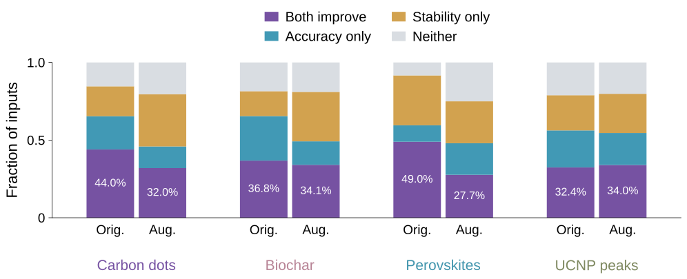
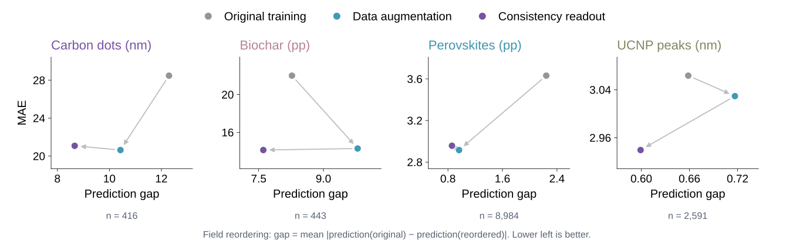

[快速开始](#快速开始)　 [实验结果](#实验结果)　 [数据集](#数据集)　　 [English](README.md)

## 从实验描述预测材料性质

输入碳点的合成条件，预测其室温磷光发射峰位。CoRead 从冻结语言模型中提取表征，用实测标签训练读出器，并约束同一实验换一种写法时的预测差异。

> **字段重排后，预测更稳定。** 在四个回归任务中，相比普通数据增广，重排前后的平均预测差降低了 **10.8%–22.3%**。

<details>
<summary><strong>查看读出原理</strong></summary>



在原文与改写之间共享读出参数 θ，用实测目标 y 监督训练。预测新样本时，只需提供实验描述。

</details>

## 快速开始

以 `carbon_dot` 为例。在仓库根目录使用 Python 3.10+ 运行以下命令。已有本地 Qwen 权重时可跳过下载。

```bash
python -m pip install ".[extract]"
hf download Qwen/Qwen2.5-7B-Instruct --local-dir models/pretrained/Qwen2.5-7B-Instruct
python run.py extract --data data/carbon_dot --model models/pretrained/Qwen2.5-7B-Instruct
python run.py demo --datasets carbon_dot
```

运行后，在 `results/run_<timestamp>/carbon_dot/predictions.csv` 查看每条样本的实测值和预测值。特征提取默认使用 CUDA；之后的读出训练可在 CPU 上完成。

<details>
<summary><strong>切换数据集与提取设备</strong></summary>

已有本地模型及分词器时跳过下载。提取入口只加载本地模型，不自动下载权重。默认使用 CUDA；CPU 提取使用 `--device cpu`，7B 模型在 CPU 上会慢很多。

对每个选用的数据集修改 `--data` 路径，各提取一次特征；之后即可在 CPU 上训练读出并保存模型。无参数 `python run.py` 使用碳点和生物炭的本地缓存。其他数据集选择示例：

```bash
python run.py demo --datasets carbon_dot biochar perovskite
```

两种 UCNP 任务也使用同一入口：

```bash
python run.py demo --datasets ucnp_peaks
python run.py demo --datasets ucnp_detection
```

</details>

## 实验结果

对同一样本，字段重排后的预测是否既更准、又更稳定？图中紫色表示绝对误差和重排预测差均严格降低的样本比例。每组两柱分别对照原文训练（Orig.）和普通数据增广（Aug.）。



<details>
<summary><strong>查看各任务的预测差与误差</strong></summary>



四项任务采用冻结 Qwen2.5-7B-Instruct 的 3,584 维表征。相对普通数据增广，MAE 变化为 **−3.0% 至 +2.2%**；越低越好。图中 pp 表示百分点，UCNP 指连续峰位回归。各图使用有效配对样本，各任务按自身协议验证。

</details>

## 数据集

| 数据集 | 样本数 | 预测目标 |
|---|---:|---|
| `carbon_dot` | 418 | 室温磷光发射峰位（nm） |
| `biochar` | 443 | 土壤镉固定率（%） |
| `perovskite` | 8,984 | 太阳能电池光电转换效率（%） |
| `ucnp_peaks` | 2,639 | 七个发射波段的峰位（nm） |
| `ucnp_detection` | 10,807 | 七个波段是否检出；9,913 条训练、894 条验证 |

**来源与许可。** 碳点和生物炭数据来自作者此前的研究，钙钛矿数据来自 The Perovskite Database Project，UCNP 数据来自 Europe PMC 和出版商文献库中的开放获取文章；UCNP 提示引用了这些文章中的实验描述。CC BY 4.0 数据许可适用于本工作生成的标签、数据划分、改写和释义；引自原文的文本仍受原文章许可约束。

## 使用参考

<details>
<summary><strong>训练、保存与预测</strong></summary>

```bash
python run.py train --data data/carbon_dot --model models/readout/carbon_dot.npz
python run.py extract --data data/new_samples --model models/pretrained/Qwen2.5-7B-Instruct
python run.py predict --model models/readout/carbon_dot.npz --features data/new_samples --output results/predictions.csv
```

预测新样本前，先准备 `data/new_samples/prompts.jsonl.gz`，每条记录包含唯一的 `sample_id`，以及 `text` 或已经格式化的 `rendered_prompt`；预测不需要标签。

使用自己的标量数据时，可沿用内置数据的标签、提示词格式，再用 `extract` 生成特征；也可将 `data/carbon_dot` 换成训练 NPZ 文件。其中 `X` 的形状为 `(样本数, 变体数, 特征维度)`，`y` 为 `(样本数,)`。变体0是原始提示，其余为等价改写；可选布尔掩码 `available` 的形状为 `(样本数, 变体数)`。

`predict --features` 支持生成的特征目录、二维 `.npy` 数组，或包含二维 `features` 数组及可选 `sample_id` 的 NPZ。训练与预测必须使用同一模型、同一层、同一输入模板和同一预处理流程。

UCNP 目录保留七波段标签：`target_B1..B7` 是峰位（nm）；`mlabel_B1..B7` 是检测标签（`-1` 未知、`0` 未检出、`1` 检出）。缺失峰位不填零，全部合格释义改写均保留。`train` 会自动识别两种 UCNP 目录；`predict` 对峰位输出七个波长，对检测输出七个概率及检出标记。

</details>

<details>
<summary><strong>Python 接口</strong></summary>

```python
from consistency_readout import ConsistencyRidge, load_model

model = ConsistencyRidge().fit(X_train, y_train, available)
model.save("models/readout/carbon_dot.npz")
predictions = load_model("models/readout/carbon_dot.npz").predict(X_new)
```

UCNP 的 Python 适配类为 `ConsistencyPeaks` 和 `ConsistencyDetection`；`load_model` 自动恢复保存的模型类型。检测概率使用 `predict_proba` 获取。

</details>

<details>
<summary><strong>目录、评价协议与复现说明</strong></summary>

| 位置 | 内容 |
|---|---|
| `run.py` | `extract`、`train`、`predict`、`demo` 的统一运行脚本 |
| `consistency_readout/` | 读出算法、输入加载和分折代码 |
| `data/<数据集>/labels.csv`、`prompts.jsonl.gz` | 随仓库提供的原始输入 |
| `data/<数据集>/features*.npz`、`features_manifest.json` | 本地生成的特征与提取检查点，不提交 Git |
| `models/pretrained/<模型名>/` | 用户准备的预训练模型及分词器，不提交 Git |
| `models/readout/` 或 `models/run_*/` | 训练好的读出权重，不提交 Git |
| `results/` | 指标、预测和运行信息，不提交 Git |
| `tests/` | 方法及完整使用流程的测试 |

仓库提供原始标签和提示词；NPZ 表征由本地 Qwen2.5-7B-Instruct 生成，不提交源码仓库。提取需要预训练模型和相应算力；提取完成后，训练读出只需本地特征缓存与 CPU 依赖（`python -m pip install .`）。

每次示例运行保存 `models/run_<时间戳>/<数据集>.npz`，并在 `results/run_<时间戳>/` 中生成 `metrics.csv`、`manifest.json` 和 `<数据集>/predictions.csv`。已有模型和结果不会被覆盖。

标量示例采用5折样本级外层评价和仅使用训练数据的3折内层选参，不代表未见论文或材料类别验证。UCNP 峰位使用固定组件分折和科学组等权评分；UCNP 检测使用固定的外部论文验证集，排除未知标签。钙钛矿和 UCNP 峰位运行的计算量较大。

已有本地缓存可以直接用于训练。提取不会覆盖已有缓存；`--resume` 只接受配置一致、校验通过的检查点。自定义 `--output-dir` 只包含特征，如要从该目录训练，还需放入对应的标签和提示词。提取会记录模型、输入哈希和运行设置；不同批次、精度或后端不保证与历史特征逐位一致。`data/features_manifest.json` 只是可选的历史参考，不是必须下载的文件。

测试命令：`python -m unittest discover -s tests`。安装 `extract` 可选依赖后会运行小模型特征提取测试。

</details>

**许可证** · 代码：[MIT](LICENSE)。数据：[CC BY 4.0](DATA_LICENSE)。
